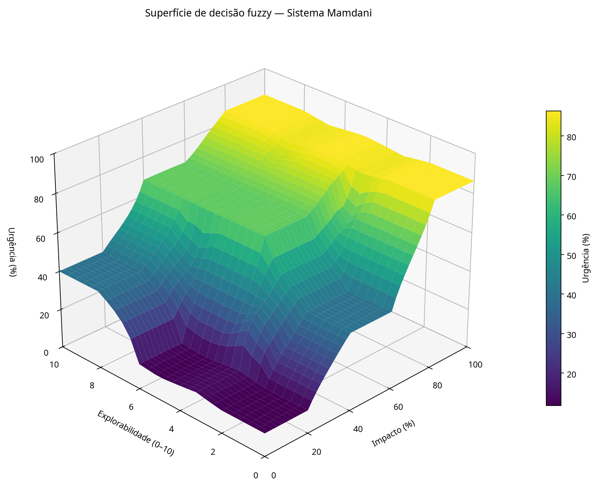

# Aula 10 — Sistema Mamdani e superfície de decisão

## Objetivo e execução

Foi implementado um sistema de inferência fuzzy Mamdani com duas entradas — **Impacto** (0–100%) e **Explorabilidade** (0–10) — e uma saída **Urgência** (0–100%). O programa usa funções de pertinência sobrepostas, valida a cobertura dos universos, executa as nove regras e produz a superfície 3D.

Para executar a atividade, instale as dependências e rode o script a partir da raiz do repositório:

```bash
python -m pip install numpy scipy matplotlib scikit-fuzzy
python AULA_10/lab01_aula10.py
```

A saída gráfica é salva em `AULA_10/superficie_decisao.png`. O teste de cobertura confirmou que não há lacunas nos universos de Impacto e Explorabilidade.

## 1. Desafio dos extremos: centroide, trapézio e MOM

O **centroide** calcula o centro de massa da área fuzzy agregada, não o maior ou menor valor permitido para a saída. Mesmo que a entrada ative totalmente o conjunto de urgência da borda, a função de pertinência ocupa uma região com largura para dentro do universo. O centro geométrico dessa região fica no interior de [0, 100], então o centroide normalmente não retorna exatamente 0% ou 100%. Os valores citados no enunciado (4,33% e 87,5%) são exemplos de uma configuração específica de funções e regras.

Na implementação desta atividade, com as funções de pertinência explicitadas no código, a comparação foi:

| Configuração | Entradas (0, 0) | Entradas (100, 10) | Entradas (50, 5) |
|---|---:|---:|---:|
| Centroide, bordas triangulares | 10,67% | 89,33% | 68,33% |
| **Abordagem A:** centroide, bordas trapezoidais | 11,76% | 86,30% | 68,33% |
| **Abordagem B:** MOM, bordas triangulares | **0,00%** | **100,00%** | 70,00% |

Os valores da primeira linha não coincidem exatamente com os números ilustrativos do enunciado porque as funções de pertinência originais que os geraram não foram fornecidas; os números acima são os resultados reproduzíveis do modelo definido em `lab01_aula10.py`.

### 1.1 Abordagem A — Trapézio na Urgência Crítica

O trapézio `[65, 82, 100, 100]` cria um patamar com pertinência máxima no limite superior. Isso altera a forma e a área que entram no cálculo, mas **não obriga o centroide a ficar em 100%**: a área continua distribuída para valores menores, e o centro de massa permanece interno. Nesta execução, a resposta de entrada máxima foi 86,30%; portanto, trocar o triângulo por esse trapézio não resolveu o extremo. O mesmo princípio explica por que o centroide não chega a zero na borda inferior.

### 1.2 Abordagem B — MOM (Mean of Maximum)

O MOM calcula a média dos valores de saída que atingem a pertinência máxima. Como os conjuntos triangulares de borda têm seu máximo em 0 e 100, respectivamente, MOM devolveu exatamente **0,00%** e **100,00%** nos dois casos extremos testados.

Esse ganho tem um custo: o MOM é sensível à posição dos máximos e pode mudar bruscamente quando muda a regra/conjunto que determina o máximo. Para verificar a suavidade, o script varia Impacto de 0 a 100 em passos de 0,5, mantendo Explorabilidade = 5. A maior mudança entre amostras adjacentes foi **2,03 pontos percentuais** com centroide e **34,69 pontos percentuais** com MOM. Assim, nos parâmetros testados, o centroide preserva melhor a suavidade; MOM crava os extremos, mas não é a melhor escolha quando uma transição estável é importante.

**Conclusão:** entre as duas alternativas pedidas, o centroide com funções triangulares/trapezoidais é preferível para manter uma resposta mais contínua no meio da escala, enquanto MOM é a alternativa direta que atingiu os extremos exatos nesta comparação. Nenhuma das duas configurações globais demonstrou simultaneamente as duas propriedades. Se ambas forem requisito, uma opção é calibrar linearmente a saída do centroide para mapear os resultados dos extremos observados a 0% e 100%; essa transformação afim conserva a continuidade, embora altere a escala numérica intermediária.

## 2. Matriz de regras 3 × 3

Cada célula da matriz é uma regra `SE Impacto é ... E Explorabilidade é ... ENTÃO Urgência é ...`. O operador E usa a conjunção fuzzy do controlador Mamdani; as saídas das regras são agregadas antes da defuzzificação.

| Impacto \\ Explorabilidade | Baixa (0–4) | Moderada (2–8) | Alta (6–10) |
|---|---|---|---|
| **Baixo (0–40)** | Urgência Baixa | Urgência Baixa | Urgência Média |
| **Médio (20–80)** | Urgência Média | Urgência Alta | Urgência Alta |
| **Alto (60–100)** | Urgência Crítica | Urgência Crítica | Urgência Crítica |

A matriz está codificada integralmente no script: baixo/baixa → baixa; baixo/moderada → baixa; baixo/alta → média; médio/baixa → média; médio/moderada → alta; médio/alta → alta; alto/baixa → crítica; alto/moderada → crítica; alto/alta → crítica.

## 3. Análise da superfície de decisão 3D

A figura foi calculada em uma grade de **1.326 pares de entrada** com defuzzificação por centroide e bordas trapezoidais. O eixo X representa Impacto, o eixo Y Explorabilidade e o eixo Z a Urgência resultante.

A superfície mostra a tendência geral definida pela matriz: impactos altos levam à região de urgência crítica mesmo quando a explorabilidade é baixa; combinações de impacto e explorabilidade baixos ficam na região de urgência baixa; e as combinações intermediárias passam pelas regiões média e alta. As sobreposições das funções de pertinência fazem as regras vizinhas contribuírem juntas nas faixas de transição, evitando lacunas e produzindo uma superfície preenchida. As mudanças de inclinação são esperadas quando a influência passa de um conjunto/regra dominante a outro; são mais suaves com centroide do que com MOM.

Nesta configuração, a superfície gerada variou aproximadamente de **11,76% a 86,30%**, reforçando que o centroide não atinge os limites exatos mesmo com os conjuntos de borda trapezoidais. A superfície não deve ser interpretada como uma relação linear: a forma depende da sobreposição e da agregação das nove regras.



## Arquivos entregues

- `lab01_aula10.py` — implementação, validação de cobertura, nove regras, comparação centroid/MOM, teste de suavidade e geração do gráfico.
- `superficie_decisao.png` — visualização 3D da superfície de decisão.
